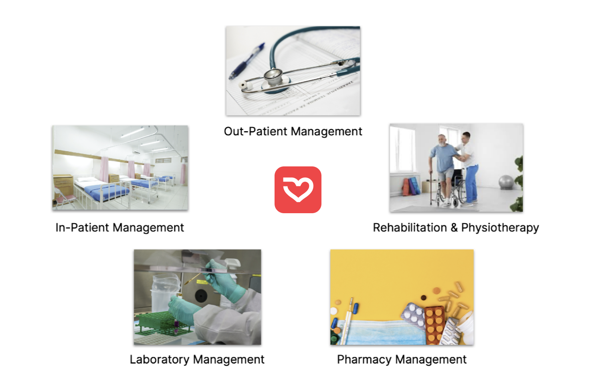

<div align="center">
  <a href="https://docs.thinknxg.com/thinknxghealth">
    
  </a>
  <h1>thinkNXG Health</h1>
  <p>Open-source hospital information system for healthcare organisations.</p>
  <p><a href="https://thinknxgcloud.com/">thinkNXG Cloud</a> · <a href="https://thinknxg.com/thinkdesk">thinkNXG Support</a></p>
</div>

## Overview

thinkNXG Health runs on thinkNXG Framework and integrates with thinkNXG ERP. It supports patient management, outpatient and inpatient care, clinical procedures, rehabilitation, physiotherapy, laboratory workflows, and multiple medical coding standards. Its design draws on HL7 FHIR.



The thinkNXG ERP integration connects healthcare workflows with pharmacy inventory, purchasing, human resources, finance, asset management, and quality management.

## Installation

Install [thinkNXG ERP v16](https://docs.thinknxg.com/thinknxgerp) in your bench, then run:

```sh
bench get-app --branch version-16 healthcare https://github.com/thinknxg/thinkNXG-Health.git
bench --site demo.com install-app healthcare
```

## Documentation

- [thinkNXG Health](https://docs.thinknxg.com/thinknxghealth)
- [thinkNXG Framework](https://docs.thinknxg.com/thinknxgframework)
- [thinkNXG ERP](https://docs.thinknxg.com/thinknxgerp)
- [thinkNXG HR](https://docs.thinknxg.com/thinknxghr)
- [thinkNXG CRM](https://docs.thinknxg.com/thinknxgcrm)
- [thinkNXG Raven](https://docs.thinknxg.com/thinknxgraven)
- [thinkNXG Cloud](https://docs.thinknxg.com/thinknxgcloud)
- [thinkDesk](https://docs.thinknxg.com/thinkdesk)
- [thinkNXG Insights](https://thinknxg.com/insights)

## License

Licensed under the GNU General Public License v3. See [license.txt](license.txt).
